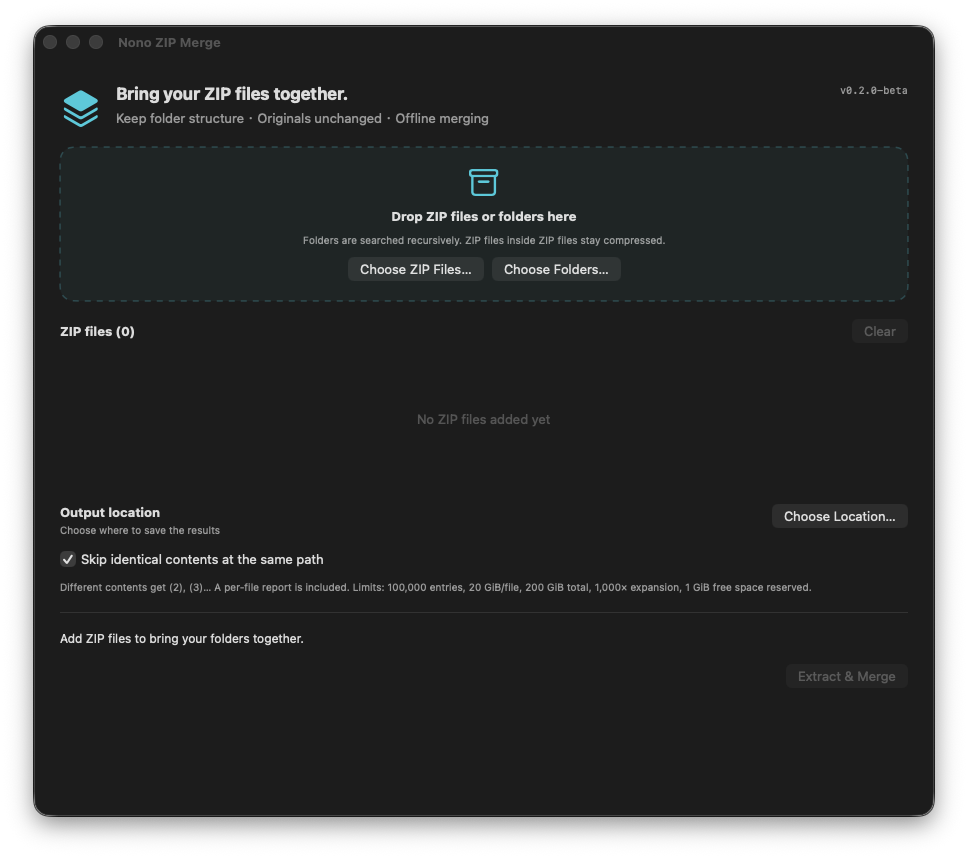
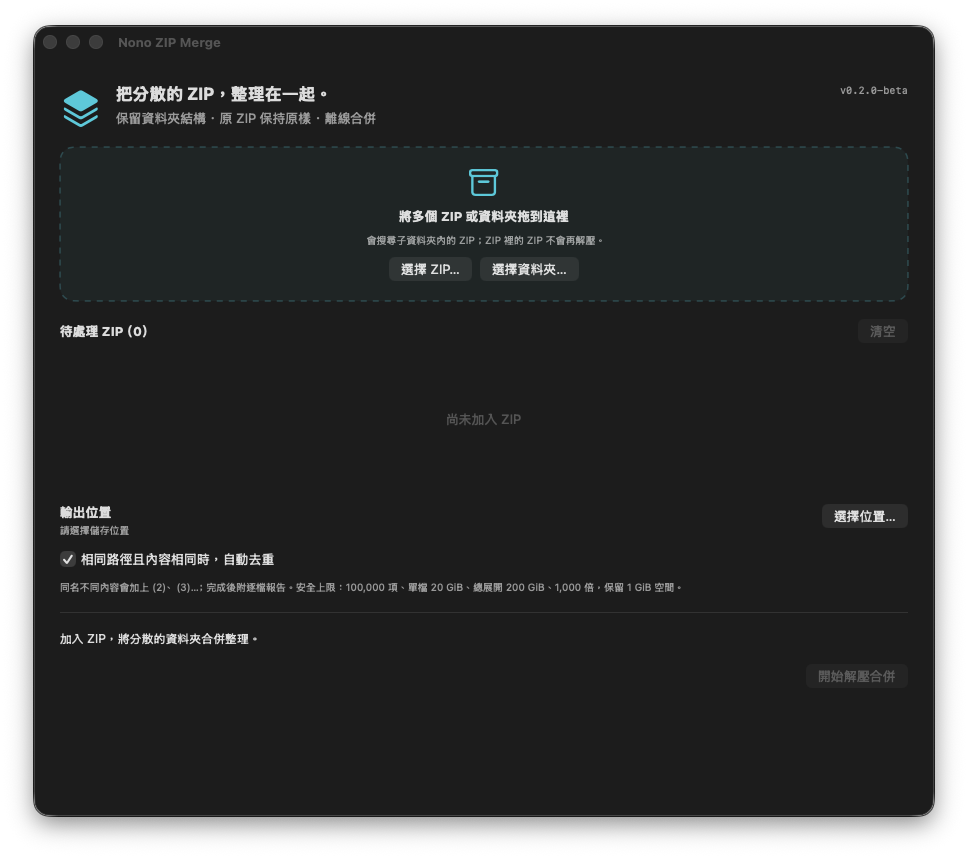
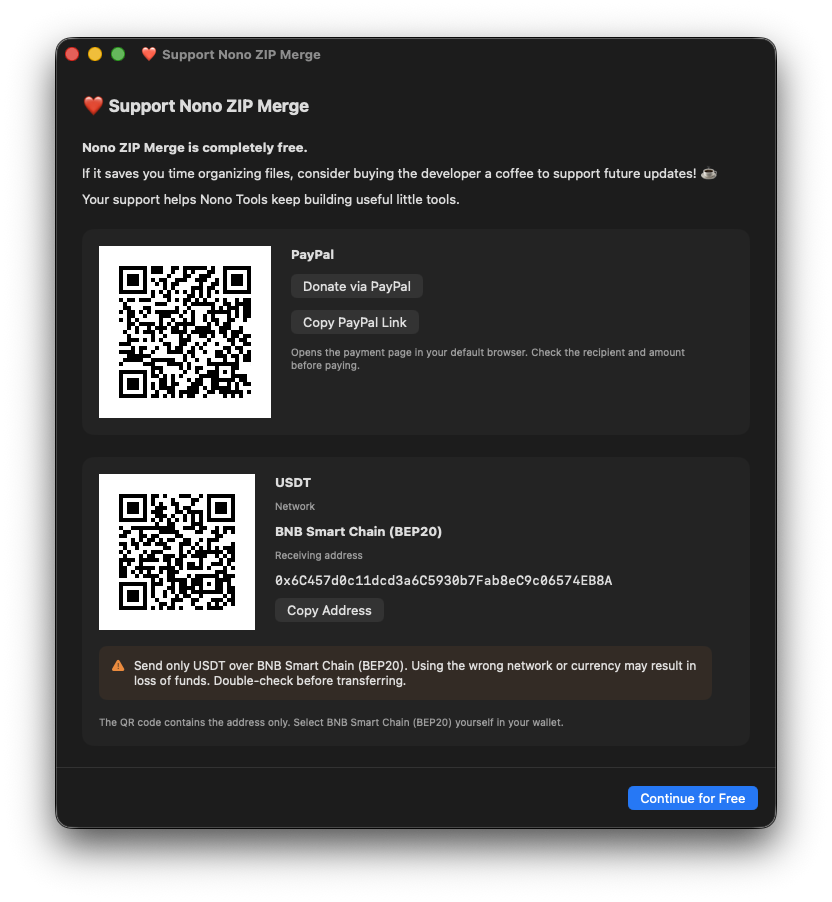

# Nono ZIP Merge

**v0.2.0-beta · macOS · Apple Silicon**

A free, native Mac utility for extracting multiple ZIP archives into one new output folder while keeping their folder structure. Merge matching folders, optionally skip identical files at the same relative path, and keep different files with numbered names.

> **Beta distribution:** this app uses a local ad-hoc signature. It is **not signed with an Apple Developer ID and is not notarized by Apple**. macOS may prevent it from opening. Do not disable Gatekeeper or remove security protections to run it. If macOS blocks this beta, wait for a Developer ID signed and notarized release.

## 繁體中文介紹

Nono ZIP Merge 是免費的 Mac ZIP 批次解壓合併工具。將多個 ZIP 或包含 ZIP 的資料夾拖入 App，選擇輸出位置，即可保留資料夾結構合併到全新資料夾；同路徑相同內容可去重，不同內容使用編號名稱保留。原始 ZIP 不會被修改。

目前為 **v0.2.0-beta 測試版**，僅使用本機 ad-hoc 簽署，**尚未使用 Apple Developer ID 簽署，也未通過 Apple 公證**。macOS 可能阻擋開啟；請勿停用 Gatekeeper 或移除安全保護，若被阻擋請等待已正式簽署及公證的版本。正式資料請先備份；完整人工驗收尚未完成。

## Download

Get the App ZIP and `SHA256SUMS.txt` from [GitHub Releases](https://github.com/nonotool0911-TW/nono-zip-merge/releases). The download asset is:

`Nono-ZIP-Merge-v0.2.0-beta-macOS-arm64.zip`

This repository contains public documentation. Compiled app downloads belong in Releases. Swift source code and development files are not published. Use of the app is governed by the Freeware terms below.

## Freeware license

Nono ZIP Merge is proprietary freeware. You may download and use the app free of charge for personal and commercial purposes. Donations are optional and are not required for either type of use.

Copyright in the app and its Swift source code remains with the copyright holder. Source code is not provided, and this permission to use the app does not transfer copyright or grant an open-source license.

Without prior authorization from the copyright holder, you may not redistribute or rehost copies of the app, resell it, or publish modified versions. Share a link to the official download page instead of distributing a copy.

“Nono Tools” is a project brand name in these documents; it is not a statement that a company or other legal entity has been registered.

These permissions do not remove the beta status, warranty disclaimer, signing limitations, or safety warnings below.

本軟體為保留著作權的 **Freeware（免費使用軟體）**，允許免費個人及商業使用，贊助完全自願。App 與 Swift 原始碼著作權仍由著作權人保留，不提供原始碼，也不授予開源授權。未經著作權人事先授權，不得重新散布、另行託管下載、轉售或發布修改版；分享時請提供官方下載頁連結。「Nono Tools」在本文中僅為專案品牌名稱，不表示已登記成立公司或其他法人。既有測試版、免責、簽章限制與安全警告仍適用。

## Requirements

- Apple Silicon Mac (arm64); this download does not contain an Intel build.
- macOS 14 or later (minimum deployment target; compatibility on each supported macOS release has not been fully tested).
- Enough writable storage for extracted files plus a 1 GiB safety reserve.
- No Homebrew, Python, Keka, or developer tools are required to use the app.

## Features

- Add multiple ZIPs, or scan selected folders recursively for ZIPs.
- Preserve relative paths and merge matching folders into a newly created output folder.
- Optional SHA-256 deduplication for matching paths; numbered names preserve different content.
- ZIP64, Unicode names, empty files, and empty folders.
- Progress, cancellation, and a per-file JSON report.
- Path, file-type, CRC, size, disk-space, and time checks. A failed archive stops the batch; partial results are not published.
- Offline extraction and QR generation. The PayPal button opens the payment website in your browser.
- Optional donations with an immediately dismissible support window; no payment, account, or registration is required to use the app.

## Eight interface languages

English · 繁體中文 · 简体中文 · 日本語 · 한국어 · Deutsch · Français · Español

The app follows macOS language preferences with an English fallback. Use **Settings…** (`Command-,`) to choose a language or follow the system. Preferences are saved and app text updates immediately. Standard macOS dialogs and menus may follow the system language.

## Quick start

1. Compare the downloaded ZIP's SHA-256 with the published checksum: `shasum -a 256 Nono-ZIP-Merge-v0.2.0-beta-macOS-arm64.zip`.
2. Extract the ZIP with Archive Utility. Move **Nono ZIP Merge.app** to a location of your choice, such as Applications.
3. Open the app using normal macOS controls, subject to the beta signing limitation above.
4. Dismiss the optional support window with **Continue using for free**.
5. Add ZIPs or folders, choose an output location, and start the merge.
6. Review the new output folder and JSON report before removing any original archives.

See the [User Guide](docs/USER-GUIDE.md) for behavior, limits, and privacy precautions.

## Voluntary support

Using the app is free. Donations are optional and do not unlock features.

- **PayPal:** use the button or QR in the app. It opens the configured payment page in your browser. Confirm the recipient, amount, and currency before paying.
- **USDT:** use the full address or QR in the app, and use **BNB Smart Chain (BEP20) only**. The QR contains a plain address and does not select a wallet network. Verify both the address and network before sending; an incorrect network or asset may cause irreversible loss.

The app does not connect to wallets, sign transactions, automatically transfer funds, or verify payments. Automated QR checks confirm the encoded text only; recipient ownership and actual payment receipt have not been verified in this preparation.

## Known limits and safety

This is beta software, supplied without warranties. Keep backups and test with disposable copies first. Do not rely on it as your only copy or as an isolation boundary for hostile files.

- ZIP only: no encrypted or split archives, RAR, 7z, self-extracting ZIPs, or compression methods other than Store/Deflate. Nested ZIPs are kept as files.
- No merging into an existing output folder; no resume, automatic updates, or GUI controls for safety limits.
- ZIP permissions, ownership, extended attributes, Finder tags, and modification times are not restored. File content is preserved.
- Destination filesystems must support exclusive atomic rename. ExFAT and network volumes need further real-world validation.
- Resource and cancellation checks are cooperative. The system archive decoder runs inside the app, without a separate CPU/memory-limited helper.
- Forced termination, crashes, or power loss can leave temporary work folders.
- Large real-world photo sets, legacy filename encodings, actual large ZIP64 files, accessibility, small displays, full GUI workflows, and fresh-download Gatekeeper behavior still need manual acceptance testing.
- JSON reports contain source and file paths. Review and redact them before sharing.

For issues, use the [issue tracker](https://github.com/nonotool0911-TW/nono-zip-merge/issues). Never attach private archives, unredacted reports, credentials, wallet secrets, or personal file paths.

[Changelog](CHANGELOG.md) · [Release notes](RELEASE-NOTES-v0.2.0-beta.md)

## Screenshots

Idle windows from the beta build; screenshots do not represent complete workflow acceptance.

